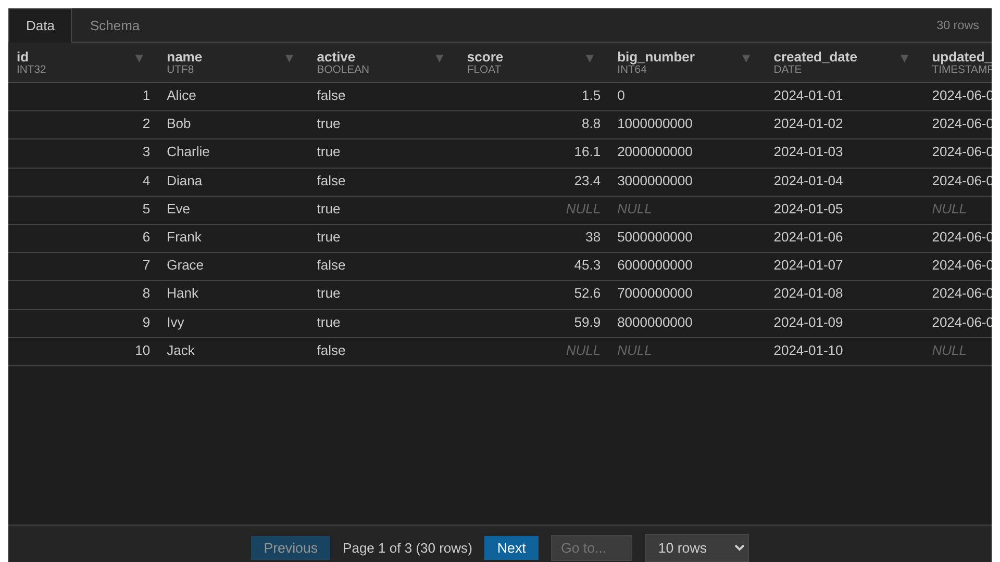
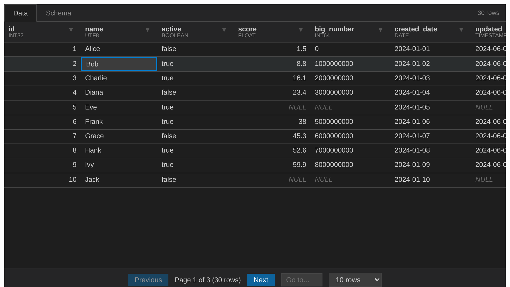
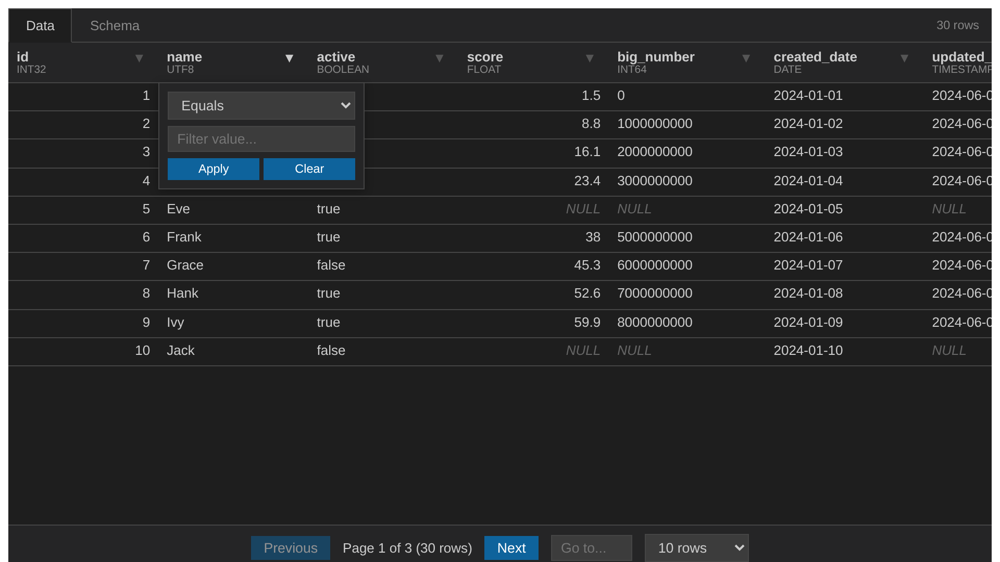
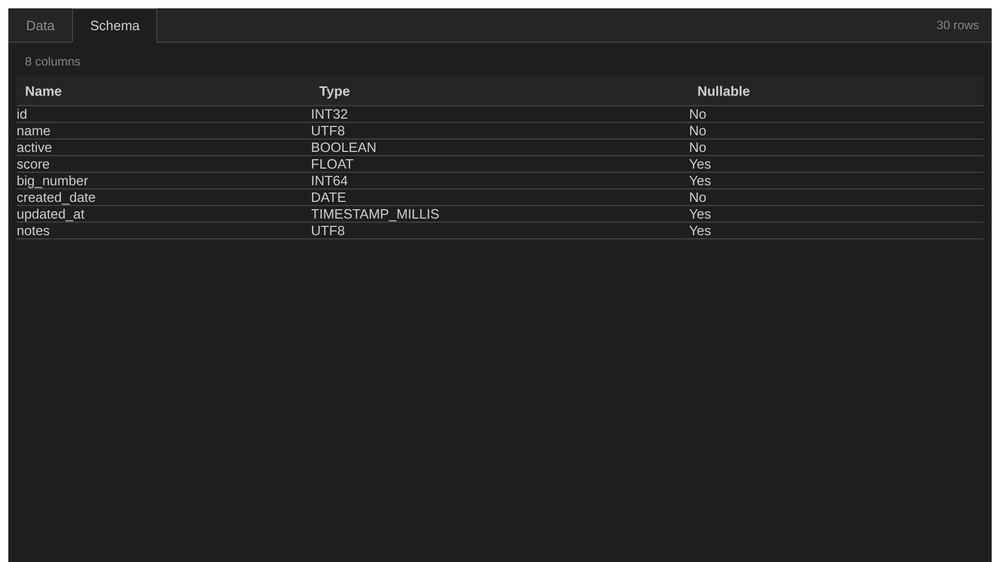

# Parquet Editor

A VS Code extension that lets you view and edit [Apache Parquet](https://parquet.apache.org/) files directly — no external tools, no command line, just open and go.

## Why?

Parquet files are compact and fast, but notoriously hard to inspect. Most workflows involve converting to CSV or firing up a Python REPL. Parquet Editor brings a familiar spreadsheet experience right into your editor.

## Features

### Spreadsheet-style data view

Browse your data with paginated navigation, NULL highlighting, and type-aware column headers.



### Click-to-edit cells

Modify values in place — type validation ensures data integrity.



### Column filters

Excel-style filtering: equals, contains, greater/less than, and more.



### Schema inspector

View column names, data types, and nullability at a glance.



### And more

- **Undo / Redo** — Full edit history with `Ctrl+Z` / `Ctrl+Shift+Z`
- **Save** — Write changes back to Parquet format with `Ctrl+S`
- **Type safety** — Supports 16 Parquet types including INT64, TIMESTAMP, BOOLEAN, and more

## Getting Started

1. Install the extension from the VS Code Marketplace (or `.vsix`)
2. Open any `.parquet` file — it opens automatically in Parquet Editor
3. Click a cell to edit, use column header filters to narrow data
4. Switch between **Data** and **Schema** tabs
5. Save with `Ctrl+S`

## Supported Types

`BOOLEAN` · `INT8` · `INT16` · `INT32` · `INT64` · `UINT8` · `UINT16` · `UINT32` · `UINT64` · `FLOAT` · `DOUBLE` · `UTF8` · `DATE` · `TIMESTAMP_MILLIS` · `TIMESTAMP_MICROS` · `BYTE_ARRAY`

## Development

```bash
npm install
npm run build        # Build extension + webview
npm test             # Run unit & property-based tests
npm run test:webview # Run webview component tests
npm run test:e2e     # Run Playwright E2E tests
npm run dev:webview  # Start webview dev server with mock data
npm run package      # Build .vsix package
```

### Pre-commit hook

A pre-commit hook in `.githooks/pre-commit` checks staged files for secrets, verifies that your git email is a noreply address, and checks `.gitignore` coverage. `npm install` activates it via the `prepare` script. If you skip `npm install`, run this once after cloning:

```bash
git config core.hooksPath .githooks
```

If a finding is a known-safe fixture, silence it with a `oss-checker:allow` comment on the same line, or `oss-checker:allow-next-line` on the line above.

## Tech Stack

- **Extension Host**: TypeScript + esbuild
- **Webview**: React + Vite + TanStack Table
- **Parquet I/O**: parquet-wasm + Apache Arrow
- **Validation**: Zod (runtime schema generation from Parquet types)
- **Testing**: Vitest (unit + property-based with fast-check) + Playwright (E2E)

## License

MIT
